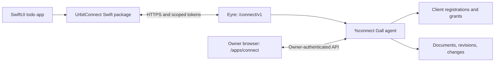

# %connect: SDK, desk, and iOS prototype design

Date: 2026-10-12

Status: implementation brief accompanying the requested plan. Product code has not been implemented or validated. The SDK-and-desk approach and ship-readable storage are user decisions; the remaining concrete defaults below are planning recommendations.

## Goal and acceptance contract

Let a developer build an ordinary iOS app whose identity session and authoritative application data live on the user's Urbit ship. Prove this with a reusable Swift SDK and a native todo app:

1. Install `%connect` on an isolated test ship and open its owner interface.
2. In the iOS app, choose that ship and tap **Connect with Urbit**.
3. Authenticate in the ship's browser interface and approve the named app's requested access.
4. Return to the app; create a list and a task, edit it, and complete it.
5. Open Connect on the ship; find the same data, edit it, export it, and manage app access.
6. Observe owner-side changes in the app; retain confirmed data through app and ship restarts.
7. Work offline, reconnect, and synchronize without duplicate writes or silent conflict loss.
8. Revoke the app on the ship; existing credentials stop reading and writing. Stored data remains available to the owner.

The first working prototype must demonstrate this in an actual iOS Simulator against an actual isolated Urbit process, over HTTPS. Simulator evidence is not physical-iPhone evidence. A signed device build and reachable host are additional gates before a device pilot; App Store publication is outside this plan.

## Agreed privacy model

- The ship can read documents. The user explicitly selected this option.
- Use HTTPS with normal certificate validation; trust the ship and any TLS terminator the owner operates or selects.
- Application-layer E2EE, host-blind document storage, and client-side key recovery are not part of this prototype. HTTPS must not be described as protecting plaintext from its TLS terminator.
- The app communicates directly with the ship. No developer data backend, central Connect account, analytics collector, or storage relay is required.
- A third-party app receives only owner-approved access within one namespace. The SDK never receives the ship's login code, owner cookie, networking private key, or wallet key.
- The client app sees the data it is permitted to render and could copy it. An SDK cannot prevent that. This is not a malicious-client sandbox.
- Permission enforcement belongs in `%connect`; editing or bypassing the SDK must not grant additional access.
- Trust the runtime, hosting machine, `%connect` updates, and other installed ship code in this prototype. Do not claim isolation from a malicious installed desk or a compromised owner web session.

## Project boundaries and selected architecture

Proposed project root: `/absolute/project`. At planning time only these documents are created there. The containing workspace is not a Git repository. Do not initialize a repository, create branches, commit, publish a desk, or change the user's existing ship as part of planning.

One desk contains one `%connect` Gall agent with versioned persistent state and focused pure libraries for authentication, authorization, storage, and HTTP encoding. Keeping grants, mutations, revisions, and idempotency receipts in one agent makes their state transitions atomic. Split agents only if measured behavior warrants it.

The agent binds `/connect/` for its protocol and `/apps/connect/` for the owner interface. A bundled TypeScript/Vite web interface provides consent and data management. It has no external scripts or service backend. The Swift package `UrbitConnect` owns authentication, Keychain credentials, HTTP transport, local SQLite persistence, and synchronization. The SwiftUI example imports that package as an ordinary consumer.



Use Hoon/Gall/Eyre for the desk; TypeScript with Vite and accessible HTML for the owner interface; Swift 6 language mode, SwiftUI, Foundation/URLSession, AuthenticationServices, CryptoKit, Security/Keychain, and system SQLite for the SDK/example. Target iOS 18+; the SDK also supports macOS 15+ for native package tests. Pin actual build dependencies and the tested Urbit runtime/kernel in execution Task 1. Do not assume a particular Kelvin from old examples.

Rejected alternatives for this prototype: ordinary Eyre owner cookies in third-party apps; an app-specific Hoon todo backend; a central authorization/data proxy; and an Obelisk dependency for simple documents. EAuth and external identity federation remain relevant future integration work.

## Identity and pairing: state the boundary honestly

Prototype discovery is explicit: the owner supplies their ship's HTTPS origin, or copies a pairing link from their authenticated Connect interface. No automatic `@p`-to-URL resolver is required. The UI must display the chosen origin and ship together.

`GET /connect/v1/info` returns `protocolVersion: 1`, `issuer` (canonical HTTPS origin plus `/connect`), `instanceId` (persistent random identifier), `syncEpoch` (restore generation), and `ship` (runtime identity). Pin the selected issuer and instance in each local account. Refuse redirects to a different origin, issuer/instance changes, invalid certificates, and unsupported major protocol versions. Reconnection to a changed endpoint requires explicit pairing again.

An account is keyed by `(issuer, instanceId)`; `ship` is its human-readable Urbit identity. A successful flow proves authorization by the owner of the explicitly selected ship endpoint. A random HTTPS server can lie about its `ship` field: this prototype does not independently prove a global Azimuth claim, wallet ownership, or continuity after a breach. Never accept the bare ship name as a globally verified login identity for an unrelated service. EAuth/Ames verification or a separately specified PKI proof is a prerequisite for later federated **Sign in with Urbit** support.

Fake ships are development identities and must be visibly labeled. First-launch copy must explain that the user needs an existing running ship with `%connect` installed and a reachable HTTPS address.

## Authorization protocol

Implement the OAuth 2.0 authorization-code flow with mandatory PKCE S256 for public native clients. This is not OpenID Connect and does not issue an ID token. Use standard OAuth error names on authorization/token endpoints; use the document error envelope elsewhere.

Prototype registration is owner-managed and static, not open dynamic registration. Seed `connect-todo-prototype` as an explicitly labeled development client with exact redirect URI `org.example.urbitconnect.todo:/oauth/callback`; its reserved example bundle identifier and custom scheme are development-only. Tests register a second client independently. Production registration requires its own publisher verification and redirect-ownership design; a supplied name/icon is not verified publisher identity.

Each grant binds a registered client, one app namespace and its `namespaceEpoch`, the approved scopes, and one session/device label. Supported scopes are `documents:read`, `documents:write`, and `documents:delete`, applying to all collections within that one namespace. No caller-supplied app name can authorize a different namespace. Only the owner can create or change registrations and grants. Scopes govern API operations, not the meaning of fields: write access can remove a nested task by replacing its containing document, even without document-delete permission. The todo app requests all three scopes.

Flow:

1. SDK creates a fresh verifier and state, records the intended issuer/client/redirect, and opens `/connect/oauth/authorize` with `response_type=code`, `client_id`, `redirect_uri`, `scope`, `state`, `code_challenge`, and `code_challenge_method=S256` using `ASWebAuthenticationSession`.
2. Ship routes the browser through its normal owner login if needed. Owner session validation must establish the local owner, not merely an EAuth visitor or the local `src` of an unauthenticated HTTP delivery.
3. Consent page shows app/development status, namespace, operations, ship, device label, and approve/deny controls. Approval uses a pending-request nonce, CSRF protection, strict Origin validation, and a state-changing POST. GET never grants access.
4. Approval issues a single-use code; callback carries code and state only. App validates state and exchanges the code with the verifier at `/connect/oauth/token`.
5. Ship issues opaque access/refresh tokens and a grant ID. Native app stores credentials in its own Keychain access group, `WhenUnlockedThisDeviceOnly`; no shared cookie jar, URL token, developer secret, or credential logging.
6. Access tokens expire after 10 minutes. Refresh tokens rotate with each use and have an absolute 30-day grant-session lifetime. Codes expire after 60 seconds; unapproved requests after 5 minutes. Tokens/codes have at least 256 bits of entropy from an appropriate kernel/system entropy-backed primitive; use SHA-256 digests for stored secret lookup, never timestamps or UUIDs as bearer secrets.
7. Replayed refresh tokens revoke their session family. SDK serializes refresh attempts; an ambiguous lost refresh response requires reauthorization rather than repeated use of a consumed token. Other device sessions stay valid.
8. Owner can revoke a session or all grants for an app. Every read, write, refresh, snapshot page, and pending change response checks current grant state. Revocation cancels pending requests and rejects future access immediately, without deleting documents.

The SDK clears its cache and stops synchronization when it learns access was revoked. It preserves unsent edits as an explicit local recovery choice until the user discards or exports them. No implementation can retract plaintext already copied by an app, or immediately inform an offline device of revocation.

Raw HTTP requests must validate their actual authentication context. `src == our` alone is not authorization. Sensitive data and grants must not be exposed through unrestricted scries, watches, generic poke forwarding, Spider, or alternate HTTP routes. All external document APIs require a bearer token; an owner cookie does not silently substitute for one. Owner APIs require the owner session and never accept an app token.

## Document contract and resource bounds

Generic namespace → collection → document model. Namespace comes from the verified grant. Collection names match `[a-z][a-z0-9-]{0,47}`. Document IDs are lower-case UUID strings created on the client. Each document has `id`, `collection`, `data` (JSON object), `revision` (decimal string), and `updatedAt` (UTC timestamp). Revisions are counters assigned by the ship, not device clocks. Bound JSON nesting to 16; reject duplicate keys, non-finite numbers, and integer values outside the interoperable JSON safe-integer range.

Mutations use `POST /connect/v1/mutations` with `{requestId, operations}`. Operations are `put` with `expectedRevision` equal to a prior revision or `null` for create-only, and `delete` with a required prior revision. A batch operates in one namespace and succeeds entirely or changes nothing. Reject duplicate targets within a batch. The SDK persists and retransmits the same request ID and exact encoded body; the server binds the receipt to the namespace, `syncEpoch`, `namespaceEpoch`, request ID, and SHA-256 body digest. Same key/body returns the previous success; a changed body produces `idempotency_mismatch`. Receipt identity does not depend on an individual login session, so an authorized retry after reauthentication can recover its earlier result within the same epochs.

Check current authorization and the required scope for every submitted operation before duplicate receipts. Keep successful receipts for 30 days, capped at 10,000 per namespace; at capacity reject new mutations until expiry, while still serving valid retries. SDK marks requests older than 30 days for explicit reconciliation, never blindly retries them under a new ID. Receipts survive restart. Receipt responses contain IDs/revisions, not full document bodies. A conflict returns HTTP 409 with the current revision or tombstone revision; include the document body only when the grant also has read permission. Never resolve by silent last-writer-wins.

Each successful batch receives one increasing namespace revision and one change batch. All changed documents use that revision. Deletes are represented in the bounded change journal. Retain lightweight deleted-ID tombstones for 30 days to support conflict handling. After tombstone expiry, a missing document remains missing; an update with a prior revision cannot create it.

Limits: 16 KiB encoded data per document; 256 KiB request body; 32 operations per mutation; 1,000 live documents and 4 MiB document payload per namespace; 16 MiB live payload across the desk; 8 registered clients; 32 active sessions across the desk. Owner and app writes share these limits. Limit the change journal to 1,024 batches or 1 MiB per namespace, whichever is reached first. Bound tombstones to 10,000 per namespace and apply capacity backpressure rather than silently discarding unexpired entries. These are conservative prototype limits, not a claim about Urbit's maximum capacity. Account for metadata and event-log growth separately in load tests.

Reads: a document GET, and collection listing ordered by document ID with `limit <= 100` and an opaque continuation token. No arbitrary predicates, joins, full-text search, user-supplied code, or unbounded scans. Scope violations return 403; unsupported/malformed requests 400; oversized bodies 413; expired credentials 401; stale cursors/snapshots 410; quotas/rate limits 429 with `Retry-After`. Never include another namespace's names, documents, or secrets in errors.

Bound request rates to 120 document requests/minute per session, and authorization starts to 30/minute per registered client. Cap outstanding authorization requests at 32 and long polls at one per session. These agent limits do not protect against upstream network-level denial of service; deployment must bound HTTP request sizes as well.

## Synchronization and offline behavior

Expose `/connect/v1/changes?after=<opaque-cursor>&wait=25&limit=100` as authenticated HTTP long polling. The cursor binds `{syncEpoch, namespaceEpoch, revision}`. Return complete change batches, a next cursor, and `hasMore`; page by batches, not partial document fragments. Recheck authorization at delivery time and stop on client cancellation. This deliberately avoids handing native apps an Eyre owner channel. SSE can be added later without changing the SDK's public change stream.

Initial/recovery synchronization uses a consistent snapshot: `POST /connect/v1/snapshots` captures a namespace view and its revision; paged GETs use a snapshot ID, `limit <= 100`, and a continuation token tied to that snapshot and session. Snapshots expire after 60 seconds, at most one per session and four globally. Then consume journal entries strictly after the snapshot revision. If either the snapshot or journal is too old, restart the snapshot. Snapshot allocations and pending polls are transient and cleared on agent reload. A normal one-shot collection list is not a substitute for a consistent snapshot.

The SDK stores confirmed documents, cursor, and pending mutations in SQLite with transactions; apply changes and advance the cursor in the same transaction. Namespace local files and Keychain items by pinned account and client ID. Exclude the cache from cloud backup and use available Apple file protection. Do not merge data from different ships, clients, or a replaced instance.

Display local edits immediately, with **Pending**, **Saved**, **Offline**, **Conflict**, **Needs attention**, or **Access revoked** state. A pending write becomes Saved only after a successful durable server response. Coalesce only edits that have never been sent; preserve exact bytes for anything possibly delivered. Retry transport failures and temporary server failures with exponential backoff and jitter, capped at 30 seconds, and honor `Retry-After`. Permanent validation/size errors retain the draft as Needs attention; do not loop on 400/403/413. Pause synchronization in the background and resume on foreground; there is no promise of continuous background delivery or push notifications.

Allow one in-flight mutation per document. If the user edits again, retain a local overlay and construct the next mutation against the acknowledged revision. A lost response is retried with the original request ID. On conflict preserve the local draft and show **Use ship version** or **Keep my version**; the latter sends a new explicitly confirmed conditional mutation against the latest revision and can conflict again. Do not resurrect remotely deleted records without an explicit new-document action.

## Todo model and interface

Use one generic collection, `lists`, with a document per list. Each document's data is:

```json
{
  "schemaVersion": 1,
  "title": "Personal",
  "tasks": [
    {"id": "9212baee-5fda-4c10-86fd-ea5e8c219ee3", "title": "Buy milk", "completed": false}
  ]
}
```

Nested tasks keep list deletion and edits atomic without adding joins, cascade rules, or todo logic to the desk. Document-level conflicts are explicit; independent edits to two tasks in the same list may conflict. The 16 KiB document limit is visible to the sample app. A later workload can introduce separate task documents without changing the generic API.

The SwiftUI app supports pairing, consent/cancel/deny, list creation/rename/delete, task creation/edit/toggle/delete, connection status, conflict resolution, and disconnect. Names must be nonempty after trimming. The SDK treats document data as generic JSON; the todo app validates `schemaVersion`, unique task IDs, and its own data model. Unsupported or malformed owner-edited documents appear as a recoverable **Unsupported list data** item; they are never silently overwritten or discarded.

The ship interface supports registered apps and sessions; grant/revoke; collection/document browsing; a version-checked JSON editor; downloading JSON exports; and confirmed deletion. Exports include version, source account, namespace, collections, and documents, but no credentials. Export uses a consistent snapshot and downloads directly to the owner's browser. An import path validates bounds and produces a preview before applying batches; partial progress and conflicts must be visible. Namespace-wide erasure is an explicit owner operation with confirmation, that namespace's grant revocation, `namespaceEpoch` rotation, and invalidation of its snapshots and receipt caches. Other namespaces and their epochs stay intact. It must not imply forensic deletion from Urbit's event history or existing backups.

UI content is bundled and escaped; document fields are always rendered as text. No third-party scripts, external app-provided logos, arbitrary HTML, or app-provided code run in the owner interface. Use a restrictive CSP, anti-framing headers, `Cache-Control: no-store` for sensitive responses, and no external CORS allowance for native APIs. CORS is not authorization. Browser SDK and cross-origin web-client support are later work.

## Lifecycle, deployment, and compatibility

- Pin a tested Urbit runtime, pill/base desk, and kernel compatibility in a toolchain manifest. Build a self-contained desk with `desk.bill`, `desk.docket-0`, `sys.kelvin`, and explicit source provenance for required base files.
- Use an isolated loopback-only fake ship for development; never reuse or mutate a production pier. Test scripts operate only within their own marked temporary directory and verify process identity before stopping anything.
- Use a test HTTPS proxy and a local CA trusted only in a disposable Simulator/browser profile. Do not disable TLS verification, add broad ATS exceptions, change the host's global trust store, or expose a fake ship publicly. Keep the proxy implementation and certificate setup reproducible.
- Require an installed iOS runtime and a created simulator. At planning time Xcode 26.6 is present, but `simctl` reports no runtimes/devices. No `urbit` binary was found on PATH; this does not prove none exists elsewhere.
- Persist documents, client registrations, grants, receipts, and revisions with explicit state versions. Fail closed on unknown versions; prove a supported upgrade preserves data and grants. Clear pending HTTP connections on reload and let clients reconnect.
- Document endpoint changes, fresh-instance detection, backup/restore, and complete pier loss. A restored old backup can restore old grants and revisions: require the owner to rotate an explicit `syncEpoch` and revoke sessions before reconnecting clients after rollback. Cursors and cached account state include this epoch; SDK never silently merges across it. Automatic rollback detection is not claimed.

## Acceptance matrix

| ID | Required evidence | Owning plan tasks |
|---|---|---|
| A1 | Clean install of self-contained desk; native app launches against its HTTPS endpoint | 1, 3, 6, 7 |
| A2 | Actual system-browser approval returns to iOS; cancel/deny/expired code work; SDK never gets owner credentials | 2, 4, 6, 7 |
| A3 | Second app cannot read/write the first app's namespace, including alternate paths and forged IDs | 3, 4, 7 |
| A4 | List/task CRUD appears in ship manager; owner JSON edit reaches the iOS app | 3, 5, 6, 7 |
| A5 | Confirmed data survives app restart, normal ship restart, isolated abrupt termination, and agent upgrade | 1, 3, 6, 7 |
| A6 | Offline edits survive app termination; reconnect yields exactly one write; conflicts preserve drafts | 3, 6, 7 |
| A7 | Revocation denies current access/refresh tokens and pending polls; owner retains data | 4, 5, 6, 7 |
| A8 | Journal gaps, snapshot expiry, namespace erasure, account changes, and restore-epoch changes trigger safe resync | 3, 5, 6, 7 |
| A9 | Consistent export/import is verified; destructive actions require precise confirmation; no secrets in export/logs | 5, 7 |
| A10 | Real UI inspection at small/large iPhone sizes, Dynamic Type, VoiceOver labels, owner desktop/mobile viewport | 5, 6, 7 |
| A11 | Bounded load/oversize/unauthorized requests leave ship responsive and other app data intact | 3, 4, 7 |
| A12 | Public Swift package consumed with no todo-specific API; another client namespace uses the same generic endpoints | 2, 6, 7 |

## Sources and limits of this design

- [Eyre HTTP API](https://docs.urbit.org/urbit-os/kernel/eyre/external-api-ref): existing communication primitives, not the proposed Connect protocol.
- [Raw Eyre handlers](https://docs.urbit.org/build-on-urbit/userspace/examples/feature): route binding and explicit HTTP authentication checks; example compatibility must be tested on the pinned kernel.
- [Desk distribution](https://docs.urbit.org/build-on-urbit/userspace/dist): desk packaging and kernel compatibility.
- [EAuth](https://docs.urbit.org/urbit-os/kernel/eyre/eauth): foreign-ship browser authentication, distinct from local-owner approval and Connect grants.
- [Gall 2026](https://urbit.org/blog/gall-2026) and [Eyre scopes proposal](https://github.com/urbit/UIPs/pull/85): installed-app isolation caveat. Proposal was open/unmerged when checked on 2026-10-12; do not treat a proposal as deployed protection.
- [RFC 8252](https://www.rfc-editor.org/rfc/rfc8252) and [RFC 9700](https://www.rfc-editor.org/rfc/rfc9700): native OAuth and security practices.
- [ASWebAuthenticationSession](https://developer.apple.com/documentation/authenticationservices/aswebauthenticationsession): native system authentication UI.

This design proposes interfaces and limits; it is not a claim that these endpoints already exist. A production federated identity service, JavaScript SDK, sharing between ships/apps, attachments, push notifications, sophisticated queries, encrypted-at-rest user keys, and audited resistance to hostile installed desks are outside the first prototype.
